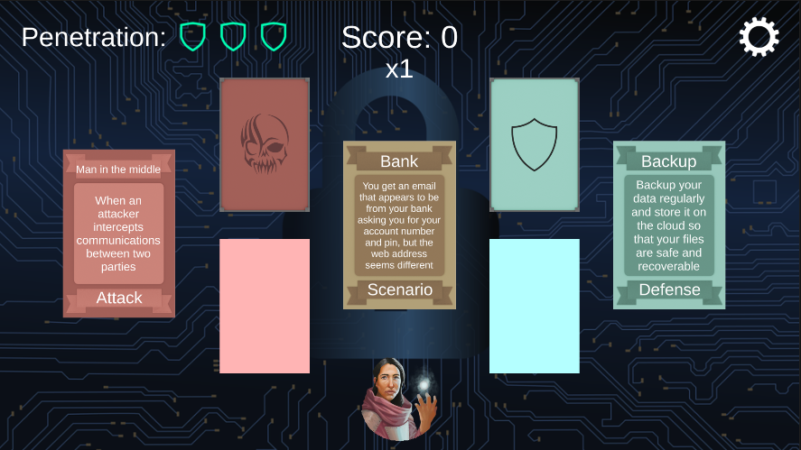
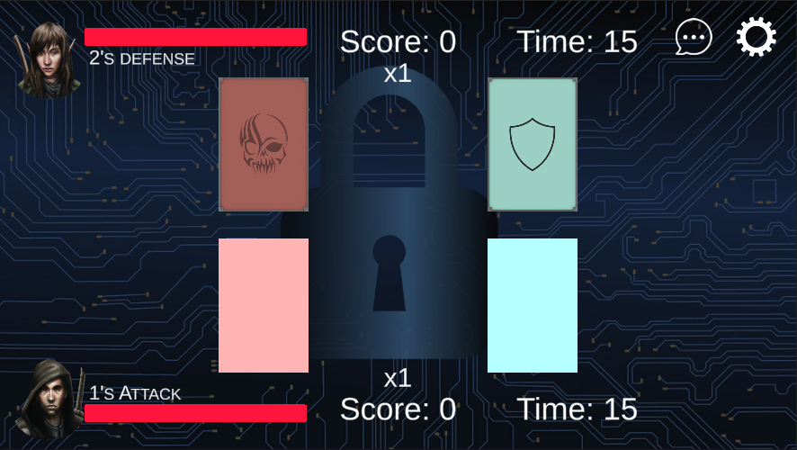

# Cyber Security Awareness Card Game

A serious card game built in **Unity (C#)** that teaches players how common cyber attacks happen and how to defend against them. Players learn by matching real-world scenarios to the right attack and defence, then put that knowledge to the test in a 1v1 online attack-and-defence match.

Built as our B.Tech Information Technology final-year project at **NMIMS MPSTME, Mumbai (2020–2021)**, under the guidance of **Prof. Pintu Shah**.



---

## Why this game

Most people are the weakest link in their own security because they simply don't recognise an attack when they see one. Textbook learning rarely changes that. A game does: players see a situation they could meet in real life ("an email that looks like it's from your bank…"), make a decision, and get immediate feedback.

The game covers:

- Phishing, vishing and smishing
- Malware and ransomware
- Web-based attacks (drive-by downloads, clickjacking)
- Denial of Service
- Identity and physical theft
- Password attacks
- Man-in-the-middle and network attacks

## Gameplay

### Level 1 – Learn (single player)
- A **scenario card** is drawn, for example a suspicious bank email, an unscanned USB stick or public café Wi-Fi.
- Drag the matching **attack card** from the attack deck, then the right **defence card** from the defence deck.
- Correct picks earn `5 × streak` points and grow the streak multiplier. A wrong pick costs 2 points, resets the streak and uses one of three attempts.
- After two wrong attempts, a **hint** unlocks. If all attempts are used, the correct cards are revealed before the next scenario.
- Scoring **200 points** unlocks Level 2.

### Level 2 – Battle (1v1 online multiplayer)
- Create or join a room by name and play against another player in real time.
- The match is built around three **asset cards** (Wi-Fi, Phone and Computer), each with its own attacks and defences.
- One player attacks and the other defends, with a 15-second timer per turn. **Roles switch every round**, so you learn to think like both sides.
- A correct defence damages the attacker's health. A wrong defence damages the defender's. Running out of time counts against you.
- The first player to reach zero health loses. An **in-game chat** lets players talk during the match.



### Also included
- Email/password registration and **Google Sign-In** (Firebase Authentication)
- Step-by-step tutorials for both levels
- An in-game manual explaining each attack and defence
- A player profile with saved scores and progress
- Music and sound-effect volume settings

## Card set

| Deck | Cards |
|---|---|
| Scenario | 20 |
| Attack | 11 |
| Defence | 13 |
| Assets (Level 2) | 3 |

## Tech stack

| Area | Technology |
|---|---|
| Engine | Unity 2019.4.10f1 (LTS) |
| Language | C# |
| Multiplayer | Photon Unity Networking (PUN 2): rooms, turn sync via `RaiseEvent`, chat |
| Authentication | Firebase Authentication + Google Sign-In |
| UI / Input | Unity UI, TextMesh Pro, touch drag-and-drop |
| Platforms | Android 5.0+, Windows 8+ |

## Project structure

```
Assets/
├── Scenes/            Menu, Level1 (single player), Level2 (multiplayer)
├── Scripts/
│   ├── Managers/      GameManager, CardManager, MultiplayerManager, AudioManager, ...
│   ├── UI/            Login, Register, Menu and multiplayer UI
│   ├── Data/          ScriptableObject definitions for cards and save data
│   └── Utility/       Deck, touch handling, tutorials, toasts
├── Data/              Card assets (Attack, Defence, Scenario, Level 2 assets)
└── Custom/            Textures, portraits and tutorial images
```

Cards are stored as **ScriptableObjects**, so new scenarios, attacks or defences can be added in the Unity editor without changing any code.

## Testing

Quality was checked in three stages:

1. **Manual functional testing.** We wrote and executed **34 test cases** covering login and registration validation (invalid email, short password, duplicate account, mismatched passwords), Google Sign-In, Level 1 scoring, streaks, hints and attempt limits, the Level 2 unlock, room creation and joining, turn timeouts (no attack, no defence, no card played), win conditions, in-game chat, **player disconnection**, profile updates and logout.
2. **User testing.** External players were given tasks (for example, "unlock Level 2 and play against another user") while thinking aloud, followed by a short interview about usability and navigation.
3. **Survey.** A Level 1 beta was shared with players, and their feedback was used to refine the gameplay.

## Getting started

### Play
Download the latest Android APK or Windows build from the [Releases](../../releases) page.

### Run from source
1. Install **Unity 2019.4.10f1** with Android Build Support.
2. Clone this repository and open the folder in Unity Hub.
3. **Firebase:** create a Firebase project, enable Email/Password and Google sign-in, and add your own:
   - `google-services.json` → `Assets/Data/Firebase/`
   - `google-services-desktop.json` → `Assets/StreamingAssets/`
4. **Photon:** create a free PUN app at [photonengine.com](https://www.photonengine.com/) and paste your App ID into `Assets/Photon/PhotonUnityNetworking/Resources/PhotonServerSettings.asset`.
5. Open `Assets/Scenes/Menu.unity` and press Play.

## Future ideas
- iOS and macOS builds
- 2v2 and team multiplayer modes
- Regular updates to the card set as new attack trends appear

## Team
- **Avrati Motwani**
- **Soham Nanavati**
- **Mayank Parvatia**: [GitHub](https://github.com/mayank2368) · [LinkedIn](https://www.linkedin.com/in/mayank-parvatia)

Guided by **Prof. Pintu Shah**, Department of Information Technology, MPSTME, NMIMS Mumbai.

## Acknowledgements
Built with [Photon PUN](https://www.photonengine.com/pun), [Firebase](https://firebase.google.com/), [Google Sign-In for Unity](https://github.com/googlesamples/google-signin-unity) and TextMesh Pro. Third-party assets belong to their respective owners.
